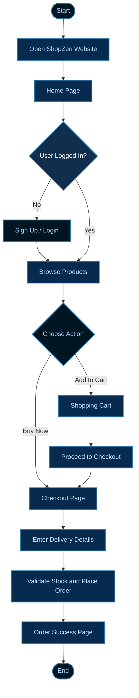
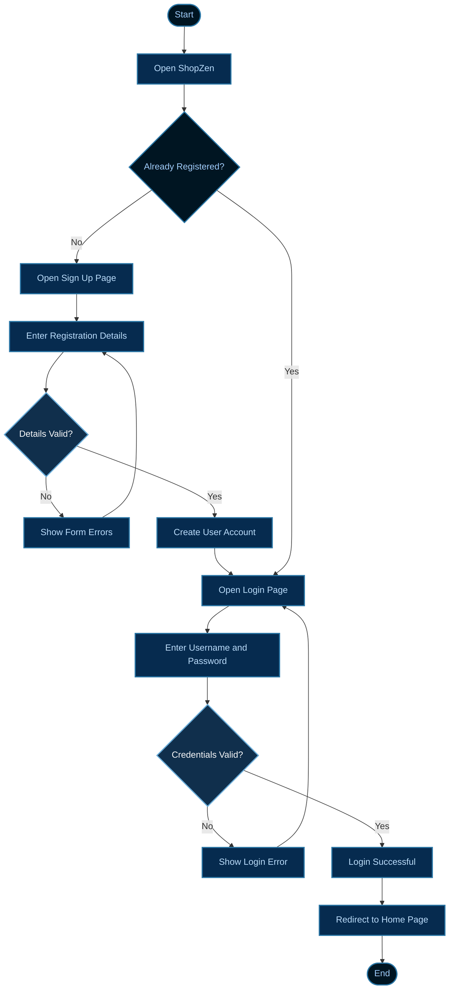
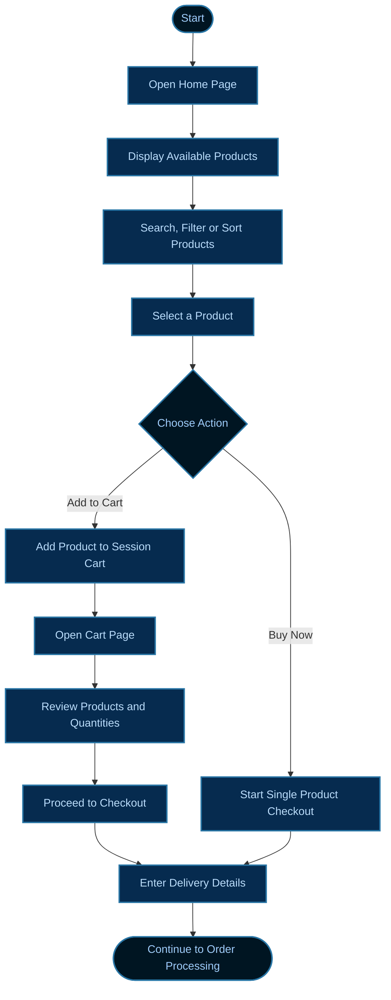
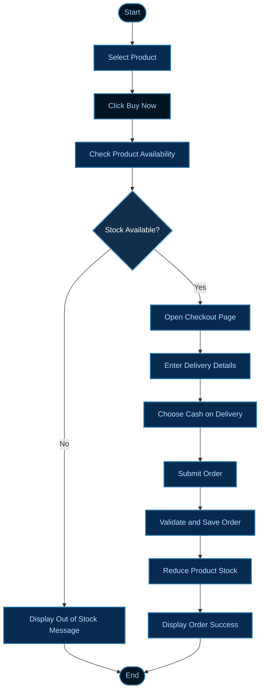
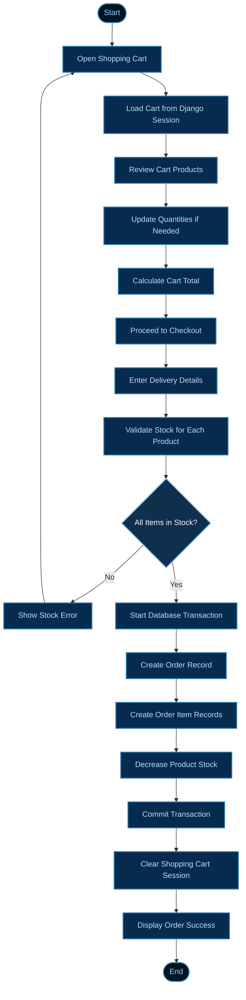
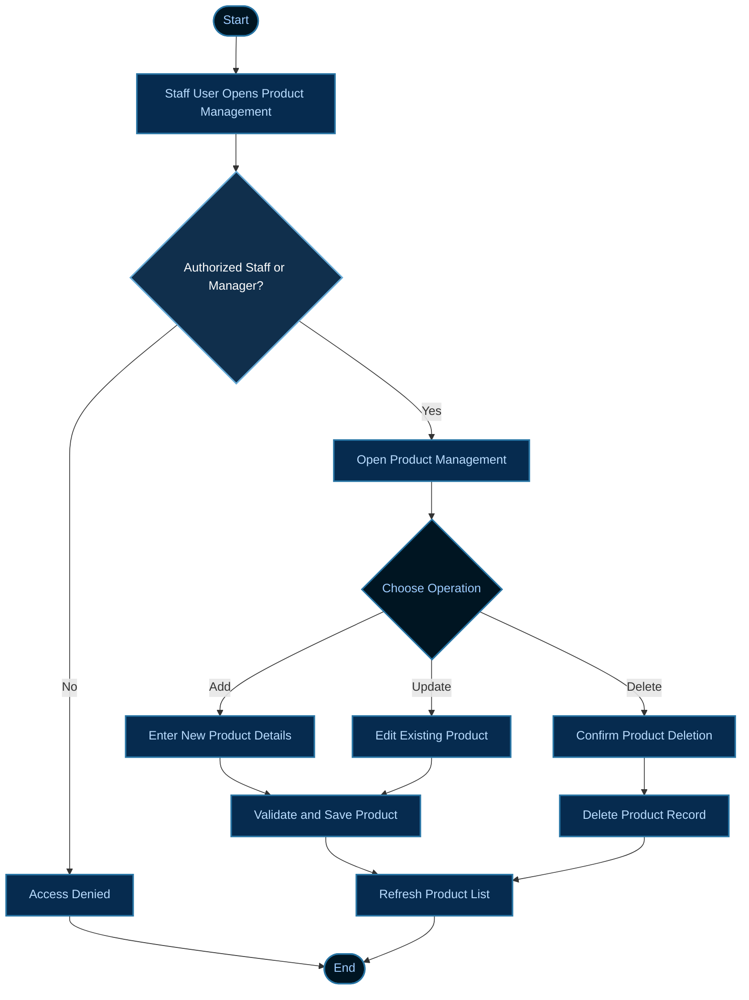
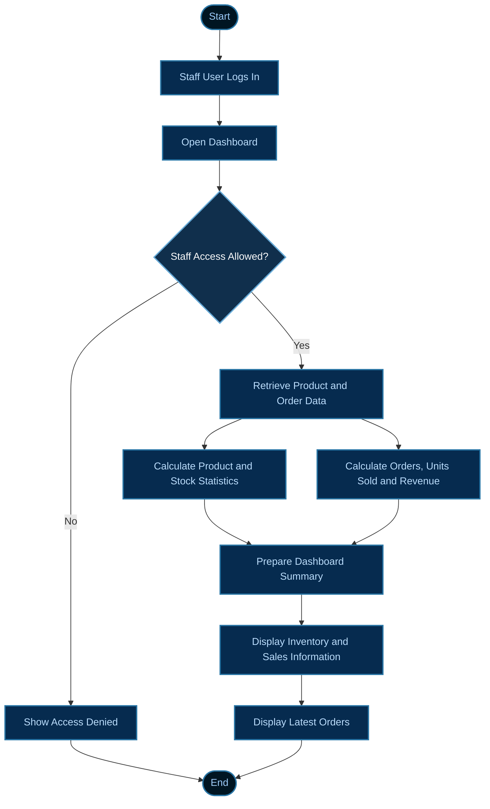
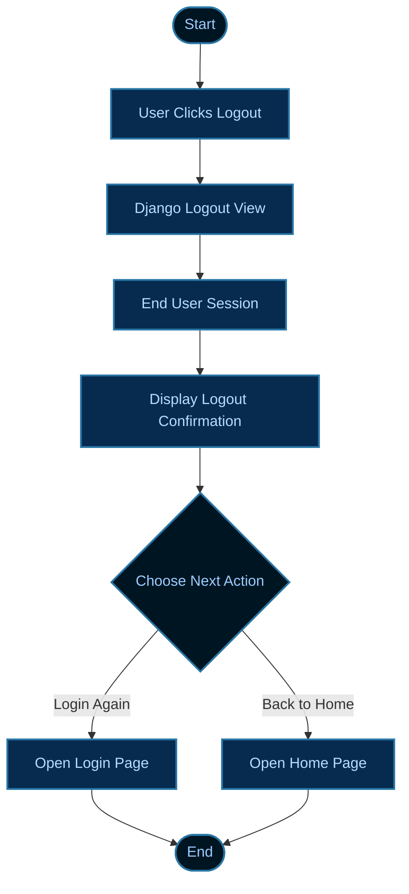

# ShopZen – Django E-Commerce Website

ShopZen is a Django-based e-commerce website. Customers can browse products, search and filter the catalogue, create an account, add products to a cart, place orders, and receive order confirmation emails. Staff members can manage products and view inventory and sales information through the dashboard.

> **Project stack:** Python, Django, MySQL, HTML, CSS, Bootstrap, Django Templates, SMTP email, WhiteNoise and Gunicorn.

---

## 1. Project information

| Item | Details |
|---|---|
| Project name | ShopZen |
| Project type | E-commerce web application |
| Backend | Python / Django |
| Frontend | HTML, CSS, Bootstrap, Django Template Language |
| Database | MySQL |
| Authentication | Django authentication |
| Cart storage | Django session |
| Email | Gmail SMTP (configurable) |
| Static files | Django static files + WhiteNoise |
| Production server support | Gunicorn |
| Main Django project | `ShopZen` |
| Main application | `testapp` |

## 2. Main features

| Feature | Description | Who can use it |
|---|---|---|
| Home page | Displays products available in the store | Everyone |
| Search | Searches products by product name | Everyone |
| Category filter | Filters products by category | Everyone |
| Price filter | Filters products by minimum and maximum price | Everyone |
| Sorting | Sorts products by price or name | Everyone |
| Sign up | Creates a customer account and attempts to send a welcome email | New customers |
| Login / Logout | Signs in and ends a customer session | Registered users |
| Forgot password | Uses Django's password-reset flow | Registered users |
| Add to cart | Adds a product to the session-based cart | Logged-in users |
| Cart | Shows cart products, quantities and total price | Logged-in users |
| Buy Now | Starts checkout for one selected product | Logged-in users |
| Cart checkout | Starts checkout for all valid cart items | Logged-in users |
| Order creation | Saves order and order-item records | Logged-in users |
| Stock management | Checks stock and decreases stock after a successful order | Automatic |
| Order confirmation | Shows order success and attempts to send an email | Logged-in users |
| Product CRUD | Adds, edits and deletes products | Staff / manager / superuser |
| Dashboard | Shows inventory totals, revenue, orders and low-stock products | Staff users |

**Important:** The current checkout code defaults the payment method to `COD` (Cash on Delivery). The project does not contain a payment-gateway integration. Do not describe it as online card/UPI payment unless a payment gateway is added.

---

## 3. Technology and dependencies

The dependencies are listed in `requirements.txt`.

| Package / technology | Purpose |
|---|---|
| Django 5.2 | Web framework, routing, ORM, authentication and admin |
| mysqlclient | MySQL database driver |
| PyMySQL | MySQL Python driver package included in the project dependencies |
| python-dotenv | Reads configuration values from `.env` |
| WhiteNoise | Serves collected static files in supported deployments |
| Gunicorn | WSGI application server |
| Django REST Framework | Installed as a dependency; the current main user flows use Django views and templates |
| argon2-cffi | Supports Argon2 password hashing |
| bcrypt | Supports BCrypt password hashing |

### 3.1 Why these technologies were used

| Technology | Why it is used in ShopZen | What it does in this project |
|---|---|---|
| **Python** | Python has readable syntax and a large ecosystem, making it suitable for building and maintaining the application logic. | Handles backend logic such as product filtering, cart operations, checkout calculations, stock validation and order processing. |
| **Django** | Django provides a structured web framework with built-in URL routing, authentication, forms, database ORM and admin features. This reduces the need to build these features from scratch. | Connects browser requests to Python views, validates form data, communicates with the database and manages user sessions and permissions. |
| **HTML** | HTML provides the structure and content of each web page. | Defines page elements such as navigation, product cards, forms, tables, buttons, cart details and dashboard sections. |
| **CSS** | CSS controls the appearance and layout of the website independently of its content. | Adds styling such as spacing, typography, colours, alignment and custom page layouts. |
| **Bootstrap** | Bootstrap provides reusable, responsive UI components and a grid system, helping pages adapt to desktop and mobile screens with less custom CSS. | Helps style navigation bars, buttons, forms, cards, tables, alerts and responsive layouts. |
| **MySQL** | MySQL is a relational database suitable for storing structured application data and relationships. | Stores product information, customer-linked orders and order items. Django models interact with the database through the ORM. |
| **Django Template Language** | It allows server-side data to be displayed inside HTML templates. | Displays dynamic product lists, user-specific information, cart totals, order details and dashboard values. |

**How the technologies work together:** The user interacts with HTML pages styled with CSS and Bootstrap. The browser sends a request to Django. Django runs Python code, reads or updates data in MySQL, and returns a rendered HTML page to the browser.

**Note:** Bootstrap is a frontend CSS framework; it does not replace HTML or CSS. Django is the backend web framework, while Python is the programming language used for the backend logic.

---

## 4. Folder structure

The important application files are shown below. Virtual environments, Git internals, generated cache files and collected static files are intentionally omitted from this overview.

```text
ShopZen/
│
├── manage.py
├── requirements.txt
├── Procfile
├── .env                  # Local secrets/configuration; do not commit
├── .gitignore
│
├── ShopZen/              # Django project configuration
│   ├── __init__.py
│   ├── settings.py       # Installed apps, database, email, static files
│   ├── urls.py           # Main URL routing
│   ├── asgi.py
│   └── wsgi.py
│
├── testapp/              # Main application
│   ├── __init__.py
│   ├── admin.py          # Product and order admin configuration
│   ├── apps.py
│   ├── forms.py          # Product and signup forms
│   ├── models.py         # Product, Order and OrderItem tables
│   ├── views.py          # Page and business logic
│   ├── tests.py
│   └── migrations/       # Database schema migration history
│
├── templates/
│   ├── navbar.html
│   ├── homepage.html
│   ├── about.html
│   ├── contactus.html
│   ├── updates.html
│   ├── dashboard.html
│   ├── signup.html
│   ├── product_form.html
│   ├── product_confirm_delete.html
│   ├── cart.html
│   ├── buy_now.html
│   ├── order_success.html
│   ├── logout.html
│   └── registration/
│       ├── login.html
│       └── password-reset templates
│
├── static/
│   ├── css/
│   └── images/
│
└── staticfiles/          # Generated by collectstatic; do not edit manually
```

---


## 5. Visual application flowcharts

The diagrams below use GitHub-supported **Mermaid flowcharts**. GitHub renders the Mermaid definitions as visual diagrams directly inside this README. No separate PNG files or `flowcharts/` folder are required.

The diagrams use dark-blue process boxes, outlined action boxes, decision diamonds and arrows to make the application flow easy to follow. The exact appearance may vary slightly with GitHub's light/dark theme.

### 5.1 Overall ShopZen application flow



### 5.2 User registration and login flow



### 5.3 Product browsing and shopping cart flow



### 5.4 Buy Now – single product checkout flow



### 5.5 Shopping cart checkout – multiple products



### 5.6 Staff product management flow



### 5.7 Admin dashboard flow



### 5.8 Logout flow



---

## 6. Page-to-page navigation (complete flow)

The following tables describe how a visitor moves from one page to another. The paths are based on the URL patterns in `ShopZen/urls.py`.

### 6.1 Public pages

| Current page | User action / link | Next page | URL |
|---|---|---|---|
| Home | Click About | About | `/about/` |
| Home | Click Contact Us | Contact Us | `/contactus/` |
| Home | Click Updates | Updates | `/updates/` |
| Home | Click Sign Up | Sign Up | `/signup/` |
| Home | Click Login | Login | `/accounts/login/` |
| Home | Select a category | Home with category filter | `/?category=Men` (example) |
| Home | Submit a product search | Home with search results | `/?q=shirt` (example) |
| Home | Apply a price range | Home with price-filtered products | `/?min_price=100&max_price=1000` (example) |
| Home | Select a sort option | Home with sorted products | `/?sort=price_low` (example) |
| Login | Click Sign Up | Sign Up | `/signup/` |
| Login | Click Forgot Password | Password reset form | `/accounts/password_reset/` |

### 6.2 Account and password pages

| Current page | User action | Next page | URL / result |
|---|---|---|---|
| Sign Up | Submit valid registration form | Login | `/accounts/login/` |
| Sign Up | Submit invalid details | Sign Up | Form errors are displayed |
| Login | Submit valid credentials | Home (configured login redirect) | `/` |
| Login | Submit invalid credentials | Login | Error is displayed |
| Login | Click Forgot Password | Password reset form | `/accounts/password_reset/` |
| Password reset form | Submit registered email | Password reset done page | `/accounts/password_reset/done/` |
| Password reset done | Open the email reset link | Set new password page | `/accounts/reset/<uid>/<token>/` |
| Set new password | Submit valid new password twice | Password reset complete page | `/accounts/reset/done/` |
| Password reset complete | Click Log In | Login | `/accounts/login/` |
| Any logged-in page | Click Logout | Logout confirmation page | `/logout/` |
| Logout confirmation | Click Log In Again | Login | `/accounts/login/` |
| Logout confirmation | Click Back to Home | Home | `/` |

### 6.3 Shopping and checkout pages

| Current page | User action | Next page | URL / result |
|---|---|---|---|
| Home | Click Add to Cart on a product | Cart | `/add-to-cart/<product_id>/` processes the POST, then redirects to `/cart/` |
| Home | Click Buy Now on a product | Buy Now / checkout | `/buynow/<product_id>/` |
| Cart | Click Continue Shopping (if provided by the template) | Home | `/` |
| Cart | Click Proceed to Checkout | Checkout form (Buy Now template) | `/checkout/` |
| Buy Now | Enter customer details and submit | Order Success | `/ordersuccess/` |
| Checkout from Cart | Enter customer details and submit | Order Success | `/ordersuccess/` |
| Checkout | Leave required details empty | Checkout again | Error message is displayed |
| Checkout | Stock is insufficient | Home or Cart | Error message is displayed |
| Order Success | Click Continue Shopping | Home | `/` |

**Login requirement:** Cart, Buy Now, Cart Checkout and Order Success are protected by login checks. A user who is not logged in will be sent through Django's login flow.

### 6.4 Staff / product-management pages

| Current page | User action | Next page | URL / result |
|---|---|---|---|
| Home | Staff clicks Add Product | Product form | `/product/add/` |
| Product form | Submit valid product | Home | Product is saved |
| Home | Staff clicks Edit on a product | Product form | `/product/<id>/update/` |
| Product form | Submit changes | Home | Product is updated |
| Home | Staff clicks Delete on a product | Delete confirmation | `/product/<id>/delete/` |
| Delete confirmation | Confirm deletion | Home | Product is deleted |
| Staff user | Open Dashboard | Dashboard | `/dashboard/` |
| Staff user | Open Django admin | Admin site | `/admin/` |

Product create, update and delete views require an authenticated superuser, staff user, or a user belonging to the `Manager` group. The dashboard uses Django's `staff_member_required`, so it requires staff status.

---

## 7. How the main workflows operate

### 7.1 Customer registration and login

1. Open the home page.
2. Select **Sign Up**.
3. Enter the username, email, password, first name and last name.
4. Submit the form.
5. Django validates and saves the user.
6. The application attempts to send a welcome email.
7. The browser is redirected to the Login page.
8. Enter the registered username and password to log in.

### 7.2 Product browsing

1. Open `/`.
2. Browse the products displayed on the home page.
3. Search by product name using the search field.
4. Select a category to filter products.
5. Enter minimum and/or maximum price to filter by price.
6. Select a sort option such as low-to-high price, high-to-low price or name.
7. The page reloads with the matching products.

### 7.3 Add to Cart

1. Log in.
2. Open the home page.
3. Select a product and click **Add to Cart**.
4. The browser sends a POST request to `/add-to-cart/<product_id>/`.
5. The view stores the product ID and quantity in the user's Django session.
6. The user is redirected to `/cart/`.
7. The cart page reads the session, fetches the matching products from the database and calculates each subtotal and the total.

The current implementation increments the quantity by one whenever the Add to Cart POST request is submitted. Cart data is stored in the session, not in a separate Cart database table.

### 7.4 Buy Now

1. Log in.
2. Select a product and click **Buy Now**.
3. The application opens `/buynow/<product_id>/`.
4. The selected product is shown as a one-item checkout.
5. Enter full name, mobile number, PIN code and delivery address.
6. Select or keep the payment method (currently defaults to COD).
7. Submit the form.
8. The application validates the required customer details.
9. It checks available stock and creates the order and order item.
10. Stock is reduced if the order succeeds.
11. The user is redirected to the Order Success page.

### 7.5 Cart checkout

1. Log in and add one or more products to the cart.
2. Open `/cart/`.
3. Click **Proceed to Checkout**.
4. The application reads cart product IDs and quantities from the session.
5. The checkout page displays the cart items and total.
6. Enter the delivery details and submit.
7. The application validates the details and checks stock for each product.
8. It creates one Order record and one OrderItem record per product.
9. It reduces the stock quantities.
10. It clears the session cart and redirects to Order Success.

### 7.6 Order and stock processing

The `create_order()` function in `testapp/views.py` performs order creation inside a database transaction.

| Step | Operation | Database effect |
|---|---|---|
| 1 | Calculate order total | Calculates the total from product price × quantity |
| 2 | Create order | Inserts one row into `Order` |
| 3 | Check stock | Ensures each product has enough stock |
| 4 | Reduce stock | Decreases `Product.stock` using a database update |
| 5 | Save order item | Inserts a row into `OrderItem` for each purchased product |
| 6 | Complete transaction | Saves all changes together if successful |

If stock is insufficient, the function raises `OutOfStock`. Because order creation is atomic, the database transaction is rolled back rather than leaving a partially completed order.

### 7.7 Staff dashboard

1. Log in using a staff account.
2. Open `/dashboard/`.
3. Review the total product count, in-stock count, low-stock count and sold-out count.
4. Review revenue, order count and units sold.
5. Review the low-stock / attention products table.
6. Review the latest orders.

The low-stock threshold is currently set to **5** in `testapp/views.py`.

---

## 8. Database tables

The application defines three main business models in `testapp/models.py`. Django also creates its standard authentication, session and admin tables.

### 8.1 Product table

| Field | Type / setting | Purpose |
|---|---|---|
| `id` | Auto-increment primary key | Unique product ID |
| `name` | CharField, max 150 | Product name |
| `category` | CharField, max 50 | Product category |
| `price` | DecimalField, 10 digits / 2 decimal places | Product price |
| `image_path` | Nullable CharField, max 255 | Relative static image path |
| `stock` | PositiveIntegerField, default 10 | Available stock quantity |

### 8.2 Order table

| Field | Type / setting | Purpose |
|---|---|---|
| `id` | Auto-increment primary key | Unique order ID |
| `user_id` | Foreign key to Django User; nullable | Account that placed the order |
| `total` | DecimalField, 12 digits / 2 decimal places | Total order amount |
| `full_name` | CharField, max 150 | Customer name at checkout |
| `mobile` | CharField, max 15 | Customer mobile number |
| `pincode` | CharField, max 6 | Delivery PIN code |
| `address` | TextField | Delivery address |
| `payment_method` | CharField, max 20, default `COD` | Selected payment method |
| `created_at` | DateTimeField, auto-created | Order creation date and time |

### 8.3 OrderItem table

| Field | Type / setting | Purpose |
|---|---|---|
| `id` | Auto-increment primary key | Unique order-item ID |
| `order_id` | Foreign key to Order | Parent order |
| `product_id` | Nullable foreign key to Product | Related product, if it still exists |
| `product_name` | CharField, max 150 | Product name saved at purchase time |
| `price` | DecimalField, 10 digits / 2 decimal places | Price saved at purchase time |
| `quantity` | PositiveIntegerField, default 1 | Quantity purchased |

### 8.4 Table relationships

| Parent table | Child table | Relationship | Meaning |
|---|---|---|---|
| Django User | Order | One-to-many | One user can place many orders |
| Order | OrderItem | One-to-many | One order can contain many order items |
| Product | OrderItem | One-to-many (nullable on order item) | A product can appear in many order items |

Simplified relationship:

```text
User
  |
  | 1-to-many
  v
Order
  |
  | 1-to-many
  v
OrderItem
  ^
  | many-to-one
  |
Product
```

`OrderItem.product_name` and `OrderItem.price` preserve a snapshot of the purchased product name and price. This means the order details can still show those values if the related Product record is later deleted.

---

## 9. Important Python files and their responsibilities

| File | Responsibility |
|---|---|
| `manage.py` | Runs Django management commands |
| `ShopZen/settings.py` | Configures apps, templates, database, email, authentication, static files and security settings |
| `ShopZen/urls.py` | Maps browser URLs to views |
| `ShopZen/wsgi.py` | WSGI entry point used by Gunicorn |
| `ShopZen/asgi.py` | ASGI entry point |
| `testapp/models.py` | Defines Product, Order and OrderItem |
| `testapp/forms.py` | Defines ProductForm and SignUpForm |
| `testapp/views.py` | Contains page rendering, search, cart, checkout, order creation and dashboard logic |
| `testapp/admin.py` | Registers products and orders in Django admin |
| `testapp/migrations/` | Stores database schema changes |
| `templates/` | Contains HTML pages rendered by Django |
| `static/` | Contains CSS and image assets |
| `requirements.txt` | Lists Python package dependencies |
| `Procfile` | Provides a Gunicorn startup command for supported platforms |

---

## 10. Local setup – step by step

### Requirements

| Requirement | What to install / prepare |
|---|---|
| Python | Python 3.10 or newer recommended; use a version supported by the installed Django and dependencies |
| MySQL | MySQL Server running locally |
| Git | Optional, if cloning from a Git repository |
| Editor | VS Code or another Python editor |
| Terminal | macOS Terminal, Linux terminal or Windows PowerShell |

### Step 1 – Get the project

If you downloaded the project ZIP, extract it. Open a terminal inside the folder that contains `manage.py`.

```bash
cd ShopZen
```

Check that the file exists:

```bash
ls
```

You should see `manage.py`, `requirements.txt`, the `ShopZen` folder and the `testapp` folder.

### Step 2 – Create a virtual environment

**macOS / Linux:**

```bash
python3 -m venv .venv
source .venv/bin/activate
```

**Windows PowerShell:**

```powershell
py -m venv .venv
.venv\Scripts\Activate.ps1
```

When activated, the terminal normally shows `(.venv)`.

### Step 3 – Install dependencies

Upgrade pip and install the project packages:

```bash
python -m pip install --upgrade pip
pip install -r requirements.txt
```

If `mysqlclient` fails to install, install the MySQL development/client libraries required by your operating system, then retry. On macOS with Homebrew, this commonly means installing `mysql-client` and ensuring its include/library paths are available.

### Step 4 – Create the MySQL database

Start the MySQL server and log in:

```bash
mysql -u root -p
```

Create the database:

```sql
CREATE DATABASE Shopzen_db
CHARACTER SET utf8mb4
COLLATE utf8mb4_unicode_ci;
```

If you use a separate MySQL user, create it and grant access to this database. Use your own secure password:

```sql
CREATE USER 'shopzen_user'@'localhost' IDENTIFIED BY 'YOUR_STRONG_PASSWORD';
GRANT ALL PRIVILEGES ON Shopzen_db.* TO 'shopzen_user'@'localhost';
FLUSH PRIVILEGES;
EXIT;
```

### Step 5 – Create the `.env` file

Create a file named `.env` in the same folder as `manage.py`. Do not upload real secrets to GitHub.

Example for a local MySQL database:

```env
DJANGO_SECRET_KEY=replace_with_a_new_long_random_secret
DJANGO_DEBUG=True
DJANGO_ALLOWED_HOSTS=localhost,127.0.0.1

DB_NAME=Shopzen_db
DB_USER=shopzen_user
DB_PASSWORD=YOUR_STRONG_PASSWORD
DB_HOST=127.0.0.1
DB_PORT=3306

EMAIL_HOST_USER=your_gmail_address@gmail.com
EMAIL_HOST_PASSWORD=your_google_app_password
```

Replace every example value with your own configuration. `EMAIL_HOST_PASSWORD` should be a Google App Password when Gmail SMTP is used with two-step verification; do not put your normal Gmail login password here.

Generate a new Django secret key if needed:

```bash
python -c "from django.core.management.utils import get_random_secret_key; print(get_random_secret_key())"
```

Copy the generated value into `DJANGO_SECRET_KEY`.

### Step 6 – Check the database connection and configuration

Make sure MySQL is running and the database credentials in `.env` are correct. Then run:

```bash
python manage.py check
```

If you see a MySQL connection error, verify the MySQL service, database name, username, password, host and port before continuing.

### Step 7 – Apply migrations

```bash
python manage.py migrate
```

This creates the required Django and ShopZen database tables.

### Step 8 – Create an administrator account

```bash
python manage.py createsuperuser
```

Enter a username, email address and password when prompted. This account can access `/admin/` and has superuser permissions.

### Step 9 – Add products

Start the server first (next step), then open:

```text
http://127.0.0.1:8000/admin/
```

Log in with the superuser account. Add Product records with a name, category, price, stock and image path.

For product images, the model stores a static relative path such as:

```text
images/img1.png
```

Place the corresponding image inside `static/images/`. The value in `image_path` must match the actual relative path used by the template.

### Step 10 – Run the development server

```bash
python manage.py runserver
```

Open:

```text
http://127.0.0.1:8000/
```

To stop the server, press `Ctrl + C` in the terminal.

### Step 11 – Test the main pages

| Test | URL | Expected result |
|---|---|---|
| Home | `http://127.0.0.1:8000/` | Product catalogue appears |
| Sign Up | `http://127.0.0.1:8000/signup/` | Registration form appears |
| Login | `http://127.0.0.1:8000/accounts/login/` | Login form appears |
| About | `http://127.0.0.1:8000/about/` | About page appears |
| Contact | `http://127.0.0.1:8000/contactus/` | Contact page appears |
| Updates | `http://127.0.0.1:8000/updates/` | Updates page appears |
| Cart | `http://127.0.0.1:8000/cart/` | Login required; then cart appears |
| Dashboard | `http://127.0.0.1:8000/dashboard/` | Staff login required |
| Admin | `http://127.0.0.1:8000/admin/` | Admin login required |

---

## 11. Creating a staff / manager account

There are two permission paths in the current code:

| Role | Product add/edit/delete | Dashboard | Django admin |
|---|---:|---:|---:|
| Normal customer | No | No | No |
| Staff user (`is_staff=True`) | Yes | Yes | Yes |
| Superuser | Yes | Yes | Yes |
| Member of `Manager` group | Yes | No, unless also staff | No, unless staff |

To make a user staff:

1. Open `/admin/` using a superuser account.
2. Open **Users**.
3. Select the user.
4. Enable **Staff status**.
5. Save the user.

To grant product-management access through the Manager group:

1. Open **Groups** in Django admin.
2. Create a group named exactly `Manager`.
3. Add the required user to that group.
4. Save.

The dashboard still requires staff status because it uses `staff_member_required`.

---

## 12. Static files

| Folder / setting | Purpose |
|---|---|
| `static/css/` | Project CSS files |
| `static/images/` | Product images and favicon |
| `STATIC_URL` | URL prefix used to serve static assets |
| `STATICFILES_DIRS` | Tells Django where the source `static/` directory is |
| `STATIC_ROOT` | Destination for collected static files (`staticfiles/`) |
| WhiteNoise | Serves collected static files in the configured deployment |

After changing CSS or image assets for a deployment, run:

```bash
python manage.py collectstatic
```

Do not manually edit generated files in `staticfiles/`. Edit the source files in `static/`, then run `collectstatic` again.

---

## 13. Email configuration

The project configures Gmail SMTP in `ShopZen/settings.py`:

| Setting | Current project configuration |
|---|---|
| SMTP host | `smtp.gmail.com` |
| SMTP port | `465` |
| SSL | Enabled |
| TLS | Disabled |
| Username | Read from `EMAIL_HOST_USER` |
| Password | Read from `EMAIL_HOST_PASSWORD` |

The application attempts to send:
- A welcome email after a successful signup.
- An order confirmation email when the order-success page is rendered.

Email delivery depends on valid SMTP credentials and network access. Signup currently uses `fail_silently=True`, so an email failure does not prevent account creation. The order confirmation view catches and prints email errors; check the server logs if the message does not arrive.

---

## 14. Important URLs reference

| Page / action | HTTP method in normal use | URL |
|---|---|---|
| Home | GET | `/` |
| Signup | GET / POST | `/signup/` |
| Login | GET / POST | `/accounts/login/` |
| Logout | GET in current route | `/logout/` |
| Password reset | GET / POST | `/accounts/password_reset/` |
| About | GET | `/about/` |
| Contact | GET | `/contactus/` |
| Updates | GET | `/updates/` |
| Dashboard | GET | `/dashboard/` |
| Admin | GET / POST | `/admin/` |
| Add to cart | POST | `/add-to-cart/<product_id>/` |
| Cart | GET | `/cart/` |
| Buy Now | GET / POST | `/buynow/<product_id>/` |
| Cart checkout | GET / POST | `/checkout/` |
| Order success | GET | `/ordersuccess/` |
| Add product | GET / POST | `/product/add/` |
| Update product | GET / POST | `/product/<id>/update/` |
| Delete product | GET / POST | `/product/<id>/delete/` |

---

## 15. Common errors and solutions

| Error / symptom | Possible reason | What to check |
|---|---|---|
| `DJANGO_SECRET_KEY is not set` | `.env` is missing or the variable is absent | Put `.env` beside `manage.py`; add `DJANGO_SECRET_KEY` |
| `Can't connect to MySQL server` | MySQL is stopped or DB host/port is wrong | Start MySQL; verify `DB_HOST`, `DB_PORT` and service status |
| `Access denied for user` | Incorrect MySQL username/password or permissions | Verify `.env`; grant the user access to `Shopzen_db` |
| `Unknown database` | Database was not created | Create `Shopzen_db` in MySQL |
| `No module named django` | Virtual environment is inactive or dependencies are missing | Activate `.venv`; run `pip install -r requirements.txt` |
| `mysqlclient` installation error | MySQL client development libraries are missing | Install the OS-specific MySQL client/development package |
| `No such table` | Migrations were not applied | Run `python manage.py migrate` |
| Static CSS or images missing | Source path or static configuration is incorrect | Check `static/`, template paths and run `collectstatic` |
| Login keeps failing | Incorrect credentials or account not created | Check username/password and Django admin Users |
| Dashboard gives 403 | User is not marked as staff | Enable Staff status in Django admin |
| Product add/edit/delete gives 403 | User is not staff, superuser or in `Manager` group | Check the user's permissions and group |
| Email not received | SMTP credentials, app password or network issue | Check `.env`, Gmail App Password and server logs |
| Cart is empty | User session has no cart items or session changed | Log in and add products again |
| Out-of-stock message | Requested quantity exceeds available stock | Update product stock in admin |

Useful diagnostic commands:

```bash
python manage.py check
python manage.py showmigrations
python manage.py migrate
python manage.py collectstatic
```

---

## 16. Deployment notes

The project includes a `Procfile` with this startup command:

```text
web: gunicorn --bind 0.0.0.0:8000 ShopZen.wsgi:application
```

The settings also include WhiteNoise, environment-based MySQL configuration, `ALLOWED_HOSTS`, `CSRF_TRUSTED_ORIGINS` and SMTP configuration. These are useful building blocks, but deployment still requires environment-specific configuration.

Before deploying:

1. Set `DJANGO_DEBUG=False`.
2. Set `DJANGO_SECRET_KEY` to a new private value.
3. Set `DJANGO_ALLOWED_HOSTS` to the actual application hostname(s), separated by commas.
4. Set `DB_NAME`, `DB_USER`, `DB_PASSWORD`, `DB_HOST` and `DB_PORT` to the production database details.
5. Add the production HTTPS origin to `CSRF_TRUSTED_ORIGINS`.
6. Configure email credentials securely.
7. Install dependencies in the server environment.
8. Run `python manage.py migrate`.
9. Run `python manage.py collectstatic`.
10. Create a superuser if required.
11. Configure the hosting platform / reverse proxy to run the WSGI application.
12. Run Django's deployment checks and test login, product browsing, checkout, stock changes, email and static files.

Example production environment values (replace placeholders):

```env
DJANGO_SECRET_KEY=your_private_production_secret
DJANGO_DEBUG=False
DJANGO_ALLOWED_HOSTS=your-domain.example

DB_NAME=your_production_database
DB_USER=your_production_user
DB_PASSWORD=your_production_password
DB_HOST=your_database_host
DB_PORT=3306

EMAIL_HOST_USER=your_email@gmail.com
EMAIL_HOST_PASSWORD=your_email_app_password
```

Run:

```bash
python manage.py check --deploy
```

Resolve the warnings reported by Django for your actual hosting environment. Do not assume the sample domain in the settings is your current deployment domain; update the allowed hosts and trusted origins to match the real domain.

---

## 17. Security and project handover checklist

| Check | Required action |
|---|---|
| `.env` | Never commit or share real secrets |
| Django secret key | Use a new private key for production |
| Debug mode | Set `DJANGO_DEBUG=False` in production |
| Allowed hosts | Add only the real application hostnames |
| CSRF trusted origins | Add the real HTTPS origin(s) |
| Database | Use a dedicated DB user with a strong password |
| Email | Use an app password or secure SMTP credential |
| Virtual environment | Do not upload `.venv/` to Git |
| SQLite / database dump | Do not share real customer data publicly |
| Admin credentials | Never put usernames/passwords in README or source code |
| Dependencies | Keep `requirements.txt` updated |
| Production check | Run `python manage.py check --deploy` |

**Important handover note:** The uploaded ZIP contains a `.env` file, a local SQLite database file, a MySQL-related configuration, a virtual environment and Git metadata. Before sharing the project publicly or uploading it to GitHub, remove private credentials and local data from the distributable copy. If any real password or secret was already committed or shared, rotate it; deleting the file in a later commit does not erase it from Git history.

A suitable `.gitignore` should include at least:

```gitignore
.env
.env.*
!.env.example
.venv/
venv/
__pycache__/
*.py[cod]
db.sqlite3
staticfiles/
.DS_Store
```

---

## 18. Current implementation notes

These notes describe the code as it exists in the supplied project, not features that are assumed to exist.

| Area | Current implementation |
|---|---|
| Product images | Stored as static path strings in `Product.image_path`; not uploaded through an ImageField |
| Cart | Stored in Django session; no separate Cart model |
| Cart quantity | Add-to-cart POST increments quantity by one |
| Checkout | Supports Buy Now for one product and checkout for cart items |
| Payment | Payment method field defaults to COD; no payment gateway is present |
| Stock | Stock is checked and reduced during order creation |
| Orders | Stored in `Order` and `OrderItem` tables |
| Customer order history | No dedicated customer order-history page is defined in the current URL configuration |
| Dashboard | Staff-only summary of inventory, revenue, orders and units sold |
| Manager role | `Manager` group can use product CRUD views; dashboard still requires staff status |
| REST API | Django REST Framework is installed, but the described storefront flow is template-based; no API endpoints are defined in the main URL configuration |
| Tests | `testapp/tests.py` exists; add and run automated tests for checkout, stock and permissions before production |

---

## 19. Quick command reference

| Task | Command |
|---|---|
| Create virtual environment | `python3 -m venv .venv` |
| Activate on macOS / Linux | `source .venv/bin/activate` |
| Activate on Windows PowerShell | `.venv\Scripts\Activate.ps1` |
| Install dependencies | `pip install -r requirements.txt` |
| Run system check | `python manage.py check` |
| Apply migrations | `python manage.py migrate` |
| Create admin user | `python manage.py createsuperuser` |
| Start local server | `python manage.py runserver` |
| Collect static files | `python manage.py collectstatic` |
| Check deployment settings | `python manage.py check --deploy` |
| View migration status | `python manage.py showmigrations` |

---

## 20. Project summary

ShopZen demonstrates a complete basic e-commerce workflow using Django and MySQL: product catalogue management, customer authentication, product search and filtering, session-based cart handling, checkout, order persistence, stock reduction, email notifications and a staff dashboard.

**Main entry point:** `manage.py`  
**Main URL configuration:** `ShopZen/urls.py`  
**Main business logic:** `testapp/views.py`  
**Database models:** `testapp/models.py`  
**HTML pages:** `templates/`  
**Static assets:** `static/`
